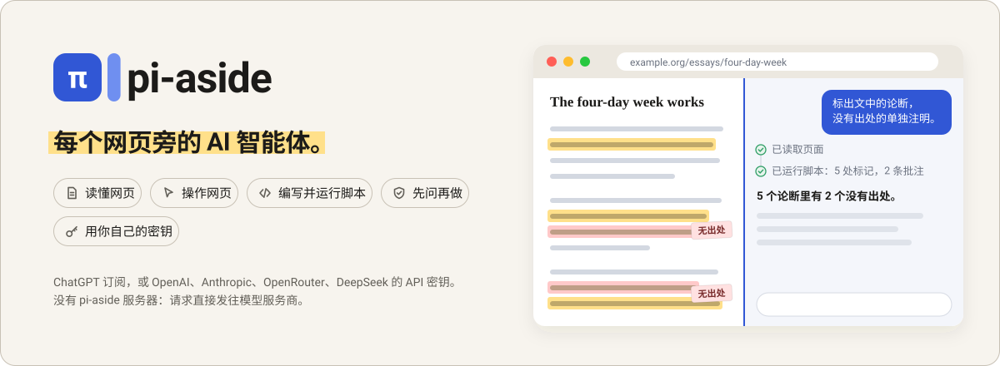
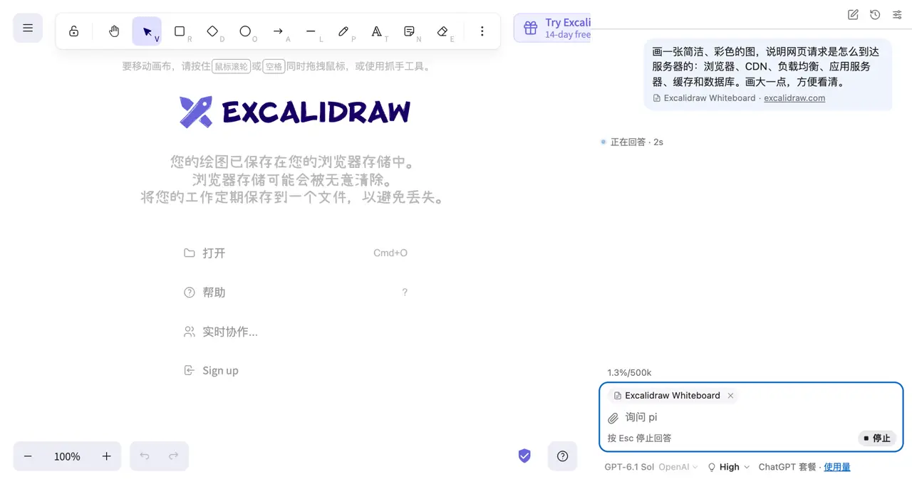

# pi-aside

[English](README.md) | 简体中文



**Chrome 侧边栏里的 AI 智能体。** 看网页时有疑问，随时问 pi；有事要办，直接交给它。它会读页面、点按钮、填表单，在网站的各个页面和标签页组之间来回切换；点击解决不了的，还会自己写脚本并运行。每一步都摆在你眼前。pi 是通用智能体，无论做什么，靠的都是读页面、观察页面、操作页面、写脚本、截图这几项基本能力。

**可以直接用你的 ChatGPT 订阅**，也可以填 OpenAI、Anthropic、OpenRouter 或 DeepSeek 的 API 密钥。pi-aside 没有自己的服务器，请求从浏览器直接发往模型服务商。

<sub>pi-aside 是一个基于 [pi-durable](https://www.npmjs.com/package/@earendil-works/pi-durable) 构建的实验性项目。</sub>

[安装](#安装) · [快速上手](#快速上手) · [使用示例](#使用示例)

## 为什么选 pi-aside

- **陪你一起读网页。** 选中一段文字，或直接在当前页面打开 pi，让它总结、解释、翻译、润色，或者帮你拟一段回复。遇到图表，它会截图来看；你也可以拖入图片或文本文件一起问。
- **不只回答，还能动手。** 点击、输入、选下拉项、翻页、切换标签页组里的其他标签页，pi 都能自己完成，每做一步都会核对结果，直到把事情办完。
- **能给网页写脚本。** 点来点去太慢、甚至做不到的事，pi 会现写一段短脚本：直接改写原网页、一次抓下长表格的全部数据，或借你的登录状态取数据。默认情况下，脚本运行前你会先看到代码。
- **任务不怕中断。** pi-aside 构建在 pi 项目的持久化智能体运行时 [pi-durable](https://www.npmjs.com/package/@earendil-works/pi-durable) 之上。每一步都实时保存：切到别的标签页或对话，任务照常进行；即使 Chrome 停掉了 pi 的后台进程，任务也能接着做完。
- **模型由你选，没有中间商。** 用 ChatGPT 订阅，或另外四家服务商的 API 密钥；每条消息都可以换模型，每个对话花了多少钱随时看得到。代码开源（MIT），不做任何使用统计。



## 安装

pi-aside 需要 Chrome 140 或更高版本。

**从发布版安装：** 在 [Releases](https://github.com/yzhg1983/pi-aside/releases) 下载 `pi-aside-<版本号>.zip`，解压到一个新文件夹。打开 `chrome://extensions`，开启右上角的“开发者模式”，点 **加载已解压的扩展程序**，选中这个文件夹。以后更新时，把新版本解压到同一个文件夹、覆盖原有文件，再点一下 pi-aside 卡片上的刷新按钮。请不要移动这个文件夹：换了位置，Chrome 会把它当成另一个扩展，原来的设置、密钥和对话记录都不会跟过去。

**从源码安装**（需要 Node.js 22.19+）：

```sh
git clone https://github.com/yzhg1983/pi-aside
cd pi-aside
npm ci --ignore-scripts   # 安装依赖，跳过安装脚本
npm run build             # 构建到 dist/
```

按上面的方法加载 `dist/` 文件夹。以后更新时，拉取最新代码、重新构建，再点一下 pi-aside 卡片上的刷新按钮即可，设置、密钥和对话记录都会保留。

## 快速上手

1. 点工具栏上的 pi-aside 图标，或者按 `Ctrl+Shift+U`（Mac 上是 `Cmd+Shift+U`）。
2. 选一家服务商，粘贴 API 密钥后保存；Chrome 请求访问权限时点允许。想用 ChatGPT 订阅，就选 OpenAI，再点 **使用 ChatGPT 继续**。
3. （可选）在 设置 > 回答 > **回答语言** 中，选择 pi 回答和翻译时使用的语言。默认跟随 Chrome 的语言。
4. 在消息框里输入问题或任务，再发送。其他用法见[从这里开始](#从这里开始)。
5. 让 pi 运行脚本：出现 **允许 pi 运行网页脚本（可选）** 卡片时，打开 Chrome 的 pi-aside 扩展详情页，向下滚动并打开 **允许用户脚本**，然后回来。跳过了？设置 > 工具 里有同一个页面的直达链接。

### 从这里开始

在需要帮忙的网页上打开 pi。Mac 上把 `Ctrl` 换成 `Cmd`（[修改快捷键](docs/guide.md#shortcuts)）。

| 想做什么 | 怎么做 |
| --- | --- |
| 询问当前页面，或交给 pi 一项任务 | 点 pi-aside 的工具栏图标，或按 `Ctrl+Shift+U`，然后输入。 |
| 询问选中的文字 | 在选中的文字上右键点 **询问 pi**，或按 `Ctrl+Shift+Y`。pi 会用星标提示词回答，默认是 **解释**。 |
| 针对选中的文字自己提问 | 在选中的文字上右键点 **添加到消息**，或按 `Ctrl+Shift+K`，然后写下问题。 |
| 使用提示词 | 在页面或选中的文字上右键，选一条提示词，比如 **总结**；也可以在消息框里输入 `/`。 |

## 使用示例

下面每个例子都只是一句话的请求，用哪些工具、分几步做，都由 pi 自己决定。这里只列举了一部分，pi 能做的远不止这些。

<sub>下面的截图和动画都是 GPT-6.1 Sol 通过 ChatGPT 套餐真实运行的结果，页面为线上实时页面。实际效果和耗时因模型和每次运行而异。</sub>

### 总结网页

*“用 5 个简短的要点总结这个页面。”* 在 Paul Graham 的文章[《How to Do Great Work》](https://paulgraham.com/greatwork.html)旁，pi 读完整页，很快给出要点，还能在同一个对话里接着追问。

### 在白板上画图

*“画一只可爱的卡通小猪，大一点、色彩鲜艳：圆滚滚的粉色身体、耷拉的耳朵、带两个鼻孔的猪鼻子、红扑扑的脸蛋、卷卷的尾巴，还有开心的笑脸。再在旁边加一块小牌子，写上‘Hello from pi’。”* 在 [Excalidraw](https://excalidraw.com/) 上，pi 用一段脚本画出来，画里每个图形都可以再编辑，最后把整幅画放进视野。



<sub>已加速播放。[完成后的静态截图](docs/images/zh-CN-diagram.png)。</sub>

### 还可以试试

- *“在这里做一个番茄钟：开始、暂停、重置，带进度圆环和柔和的配色，然后运行它。”* 在 [JSFiddle](https://jsfiddle.net/) 上，pi 写好 HTML、CSS 和 JavaScript，运行后测试各个按钮。
- *“新建一个 Python 笔记本，载入泰坦尼克号乘客数据 https://raw.githubusercontent.com/mwaskom/seaborn-data/master/titanic.csv ，按舱位等级和性别画出生还率，再列出 3 个主要发现，每个一句短话。”* [JupyterLite](https://jupyter.org/try-jupyter/lab/) 直接在网页里运行 Python；pi 写好代码单元、运行，再解读图表。
- *“最新的 100 个未关闭 issue 分属哪些领域？在这个网页上画出领域分布图，并标出讨论最多的 5 个。”* 在 [VS Code 的 issue 页面](https://github.com/microsoft/vscode/issues)，pi 读完最新的 100 个 issue，归入各个领域，再把分布图加到页面上。
- *“对比一下这个标签页组里的三台笔记本：价格、重量、续航和接口。”* pi 逐个读取标签页，整理成一张表。
- *“按下面的信息填好这张表单，提交前停下。”* pi 逐项填写，最后那一下提交留给你自己点。

把常用任务存成提示词：[页面内翻译、YouTube 视频总结](docs/prompts.zh-CN.md)。

## 由你掌控

在 设置 > 工具 里，每个工具（读取页面、观察页面、操作页面、运行脚本、截取页面）都可以设为关闭或开启，操作页面和运行脚本还可以设为询问。默认情况下，操作页面和运行脚本都会先问过你。

**无论模型怎么说，pi-aside 都会守住这些底线：**

- 在“询问”模式下，每次回答里 pi 第一次在某个网站上动手之前，都要先经你同意；每段脚本运行前，都会完整展示代码。
- 如果 Chrome 在点击或脚本执行到一半时停掉了 pi，pi 不会重做这一步，而是告诉模型这一步可能已经生效，让它先检查页面。读取页面这类重做一次也无妨的步骤，则会直接重新执行（详见[用户指南](docs/guide.md#when-chrome-stops-pi)，英文）。
- 只有你在某个标签页上打开过 pi，或者该网站已经被你允许，pi 才会读取这个标签页。
- pi 只在当前网站内跳转，除非你允许它去别的网站。
- 密码、银行卡、一次性验证码输入框，pi 绝不往里输入；读取页面时，也会略去你在表单里填写的内容。
- 每一步都会显示在对话里，随时可以点“停止”或按 Esc 结束任务。pi 工作时你发出的消息，会在当前步骤完成后并入任务，方便你中途纠正；按 Alt+Enter 则会等回答结束后再发送（可在 设置 > 发送 里互换两者）。

**只能要求、无法强制：** 提交、发送、删除、购买或下载之前先向你确认；绝不填写支付信息；不理会网页上写给它的指令。

**仍需留意：** pi 以你的身份、凭你的登录状态操作。网页里可能藏着故意误导它的文字，模型也难免出错。在邮箱、网银、管理后台，以及任何点错就麻烦的地方，请保持“询问”模式。

## 隐私

- 没有 pi-aside 服务器，也不做任何使用统计；请求直接发往你选择的服务商。
- “设置 > 模型”中的“更新”从 pi.dev 下载公开的模型列表，不发送密钥、对话或网页内容。
- 对话、设置和密钥都保存在你的 Chrome 个人资料里，其中密钥没有加密。
- 对话会一直保留，直到你在 设置 > 高级 > 数据 里全部删除。详见 [PRIVACY.md](PRIVACY.md)（英文）。

## 了解更多

- [用户指南](docs/guide.md)（英文）：设置、图片与文本文件、对话与历史记录、提示词与斜杠命令、模型与思考、编辑提问、图示、联网搜索、快捷键、语言和使用限制。

pi-aside 是非官方项目：开发 pi-durable 的 pi 项目既没有参与开发，也没有为它背书。

## 许可证

[MIT](LICENSE)。打包进来的第三方依赖沿用各自的许可证，每次构建都会把它们列在 `dist/THIRD_PARTY_NOTICES.txt` 里。
